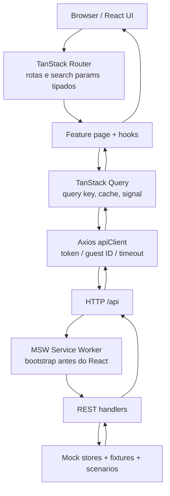
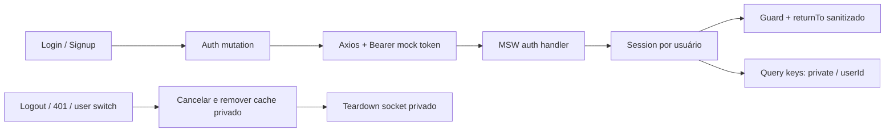
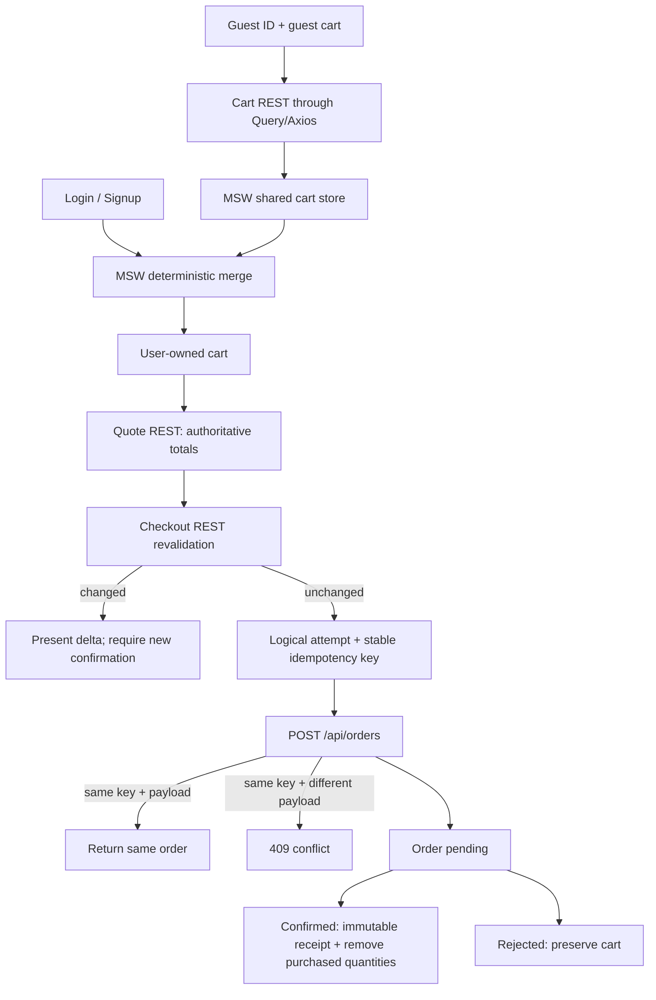

# Mapa final da arquitetura

Este mapa representa a implementação do repositório, não uma arquitetura de backend produtivo. Em dev/demo, MSW ocupa a fronteira de rede e mantém estado simulado local.

## Runtime e request REST



## Estado de sessão e isolamento



Query cache isolation is not authorization: a real server must independently authorize every resource request. Mock owner checks demonstrate the intended contract only.

## Catálogo e concorrência

```mermaid
sequenceDiagram
  actor U as User
  participant R as TanStack Router
  participant P as HomePage
  participant Q as TanStack Query
  participant A as Axios
  participant M as MSW / REST handler
  U->>R: search params (q, filters, sort, page)
  R->>P: validated typed search
  P->>Q: useNFTCatalog(params)
  Q->>A: queryFn(signal)
  A->>M: GET /api/nfts + params
  M-->>A: filtered/paginated response + metadata
  A-->>Q: response
  Q-->>P: data for matching query key
  P-->>U: cards, empty/error/loading
  Note over Q,A: New key identifies new search; AbortSignal reaches Axios.
```

## Guest cart, quote e pedido



ETH values remain decimal strings in API/domain presentation. Mock arithmetic converts them to integer wei using `bigint` (`src/lib/eth-decimal.ts`); it does not use JS floating point.

## Realtime e REST reconciliation

```mermaid
sequenceDiagram
  participant Store as Shared mock store
  participant Binding as MSW Socket.IO binding
  participant Client as socket.io-client
  participant Consumer as Realtime event consumer
  participant Query as TanStack Query cache
  participant REST as REST authority
  Store->>Binding: publish versioned resource event
  Binding-->>Client: Socket.IO event over intercepted WebSocket
  Client->>Consumer: nft.updated / order.updated
  Consumer->>Consumer: validate identity, session, eventId, version, terminal state
  alt duplicate/stale/foreign event
    Consumer-->>Client: ignore
  else newer valid event
    Consumer->>Query: update relevant detail/order and invalidate related keys
    Consumer->>REST: refetch/revalidate as needed
    REST-->>Query: authoritative current state
  end
  Note over Client,REST: reconnect invalidates active resources; REST fills missed events.
```

Socket transport is real from the application's perspective (`socket.io-client` handshake/events), but the server endpoint is MSW-bound for demo/test. No blockchain, real payment processor, Socket.IO cluster, rooms or distributed broadcast are present.

## Main code landmarks

| Concern | Files |
|---|---|
| bootstrap/providers/router | `src/main.tsx`, `src/app/providers.tsx`, `src/app/router.tsx` |
| Query/Axios/contracts | `src/app/query-client.ts`, `src/lib/query-keys.ts`, `src/api/client.ts`, `src/types/` |
| catalog | `src/features/catalog/`, `src/features/nft/`, `src/mocks/handlers/catalog.ts` |
| auth/favorites | `src/features/auth/`, `src/features/favorites/`, `src/mocks/handlers/auth.ts` |
| cart/quote/ETH | `src/features/cart/`, `src/lib/eth-decimal.ts`, `src/mocks/state/cart-store.ts` |
| checkout/orders | `src/features/checkout/`, `src/features/orders/`, `src/mocks/state/orders-store.ts` |
| profile/wallets | `src/features/profile/`, `src/features/wallets/`, `src/mocks/state/wallets-store.ts` |
| realtime | `src/realtime/`, `src/mocks/socket/server.ts`, `src/mocks/handlers/realtime-scenarios.ts` |
| REST scenarios | `src/mocks/handlers/`, `src/mocks/scenarios/`, `tests/helpers/mock-scenarios.ts` |
| verification | `tests/*.spec.ts`, `playwright.config.ts`, `scripts/lighthouse-audit.mjs` |

## Evidências por fluxo

- Catalog/history/race: `tests/catalog.spec.ts`
- Session/favorites/rollback: `tests/auth-favorites.spec.ts`
- Guest cart/quote/merge: `tests/cart.spec.ts`
- Checkout/idempotency/snapshot: `tests/checkout-orders.spec.ts`
- Profile/wallet isolation: `tests/profile-wallets.spec.ts`
- Socket/version/reconnect: `tests/realtime-failures.spec.ts`
- global route/visual coverage: `tests/visual-regression.spec.ts`, `evidence/lot-*/`
- deployed route/MSW/socket smoke: `evidence/lot-08/public-smoke.md`
